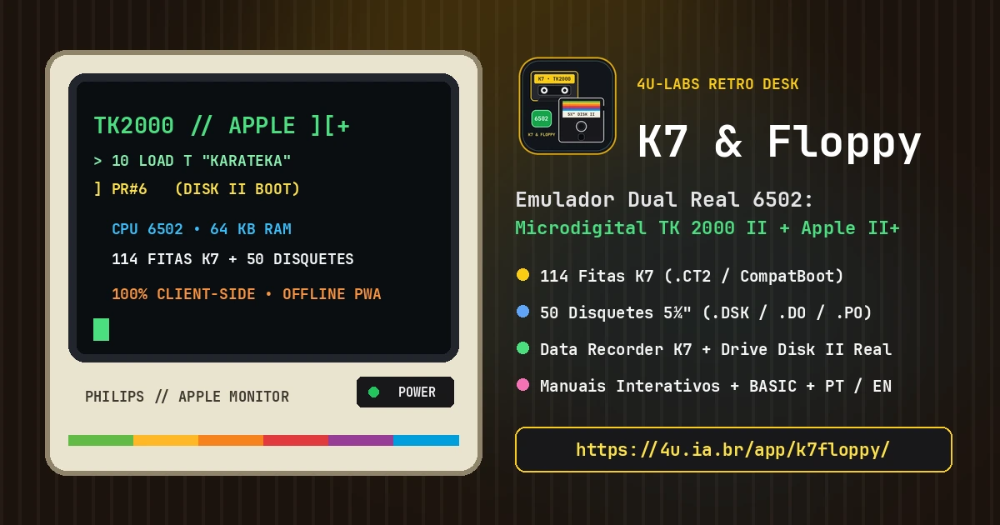

# K7 & Floppy — Microdigital TK 2000 II & Apple II+ (6502 Retro Desk)

**K7 & Floppy** é uma bancada interativa e emulador fiel de **CPU MOS 6502** no navegador que reúne dois marcos dos anos 80 em um único computador retrô com alternância instantânea:

- 🇧🇷 **Microdigital TK 2000 II:** Gravador Data Recorder K7 realista, leitura e gravação em **`.CT2` / `.WAV`** (via `SAVE T` / `LOAD T`), modo Turbo K7, **110+ títulos prontos em fita K7**, teclado matricial 8×6 autêntico e Manuais interativos de TK-BASIC.
- 🍎 **Apple II+:** Drive **Disk II 5¼"** com latch mecânico e áudio de seek, boot de imagens **`.DSK` / `.DO` / `.PO`**, **50 clássicos em disquete**, Joystick / Paddle (`$C064/$C061`) com detecção automática de controles da RAM e Manuais de Applesoft BASIC.

🌐 **Acessar Online:** [https://4u.ia.br/app/k7floppy/](https://4u.ia.br/app/k7floppy/)  
📦 **Download dos Packs Completos (GitHub Releases):**
- [`tk2000.zip` (1,5 MB — 140 arquivos entre fitas .CT2, imagens CompatBoot TK-2000 e manuais)](https://github.com/4u-Labs/k7floppy/releases/download/v1.0.0/tk2000.zip)
- [`appleii.zip` (2,1 MB — 50 disquetes .DSK/.DO/.PO clássicos de Apple II+)](https://github.com/4u-Labs/k7floppy/releases/download/v1.0.0/appleii.zip)

---

## Principais Recursos

- **Emulação Real 6502 em JavaScript Puro:** Sem dependências externas ou servidores de streaming; roda 100% client-side com renderização CRT (Colorido, Fósforo Verde P31, Âmbar P3 e Scanlines) e som 1-bit via Web Audio.
- **Interface Simétrica & Imersiva:** Ao alternar entre **TK 2000 II** e **Apple II+**, mudam o chassi, a placa de identificação, o monitor, o periférico esquerdo (Data Recorder K7 ou Disk II 5¼") e os manuais espiralados na mesa.
- **Gaveta Visual & Caixa de Disquetes:** Filtros instantâneos por categoria, busca em tempo real e catálogo em tela cheia com dicas de teclas/joystick detectadas automaticamente na memória.
- **Bilíngue PT-BR / EN + PWA Offline:** Tradução em tempo real, instalável como aplicativo e compatível com arquivos `.CT2`, `.WAV`, `.DSK`, `.DO`, `.PO` e `.ROM` arrastados para a mesa.

---

## Ecossistema 4u-Labs

Parte da linha retrogaming e software livre da **[4U.IA.BR / 4u-Labs](https://4u.ia.br/)** · [Loja Oficial 4U Hub](https://4u.ia.br/loja/) · [Blog Técnico](https://4u-labs.github.io/).
